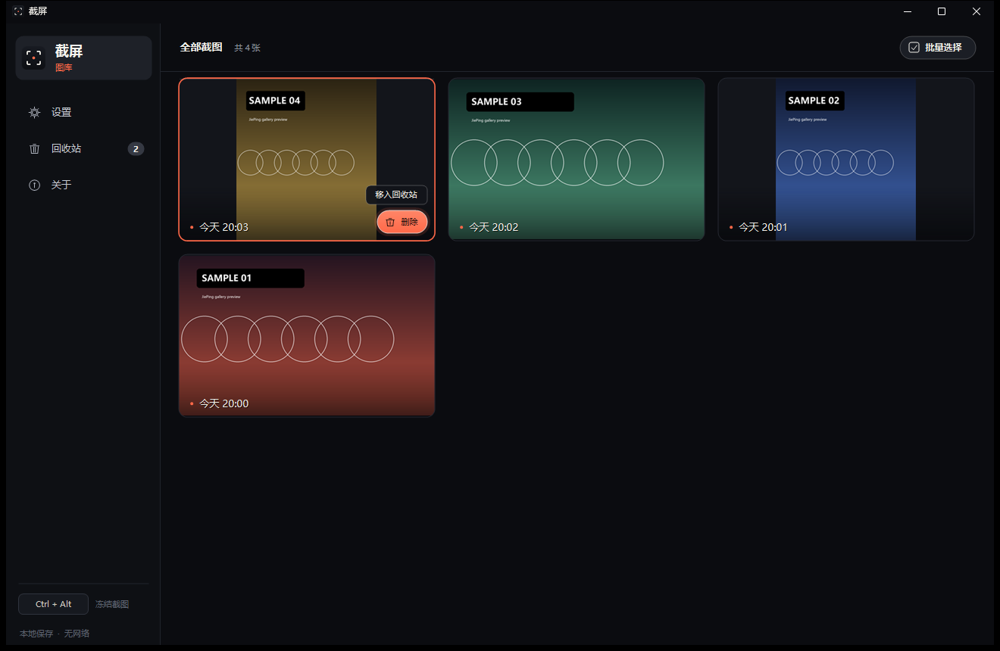
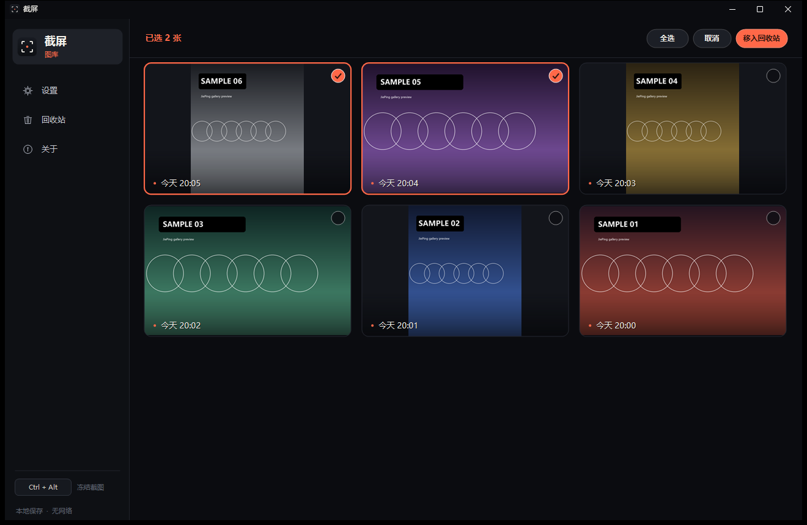
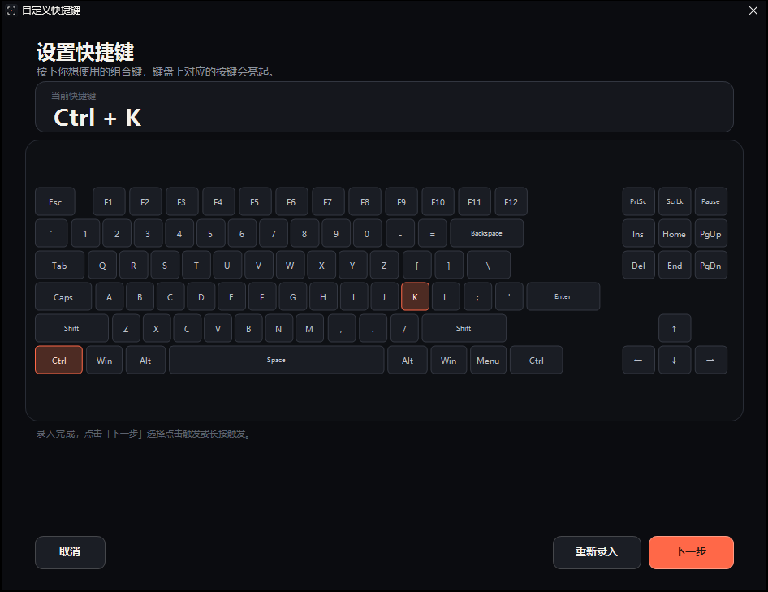
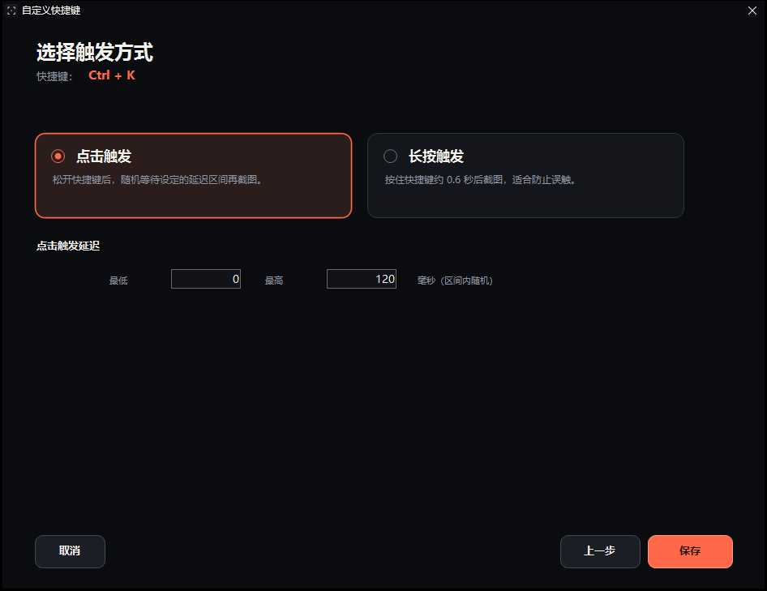
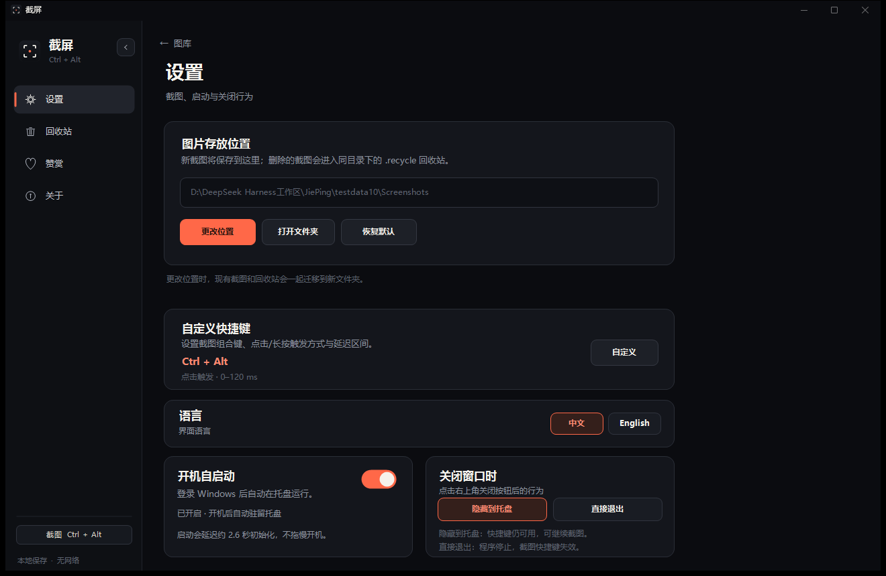
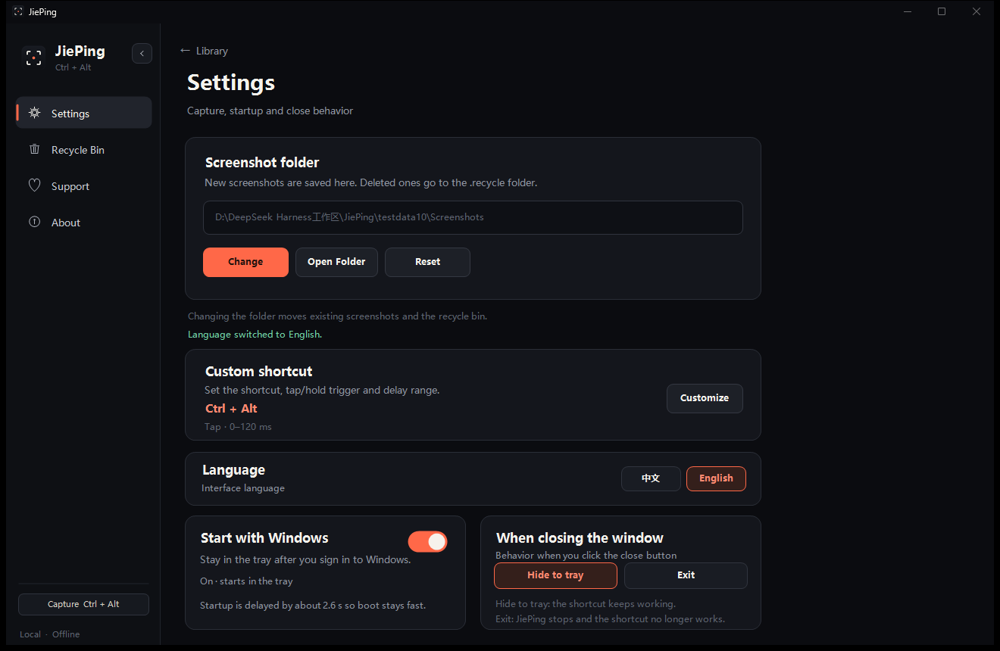
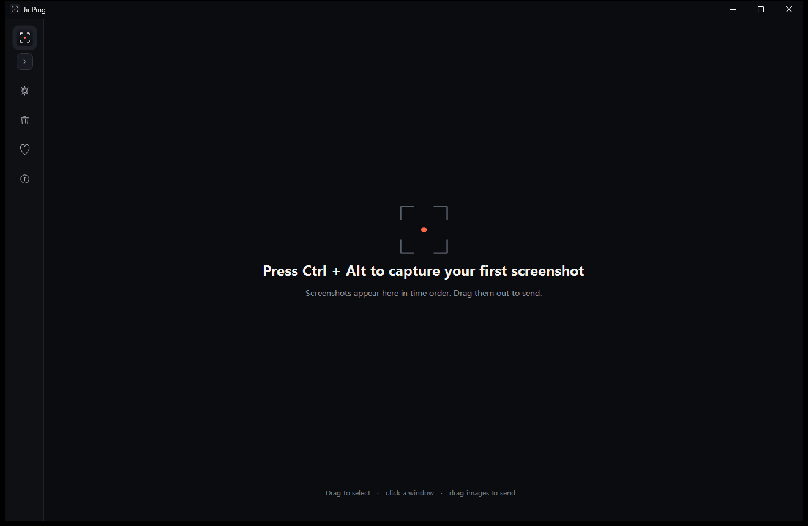
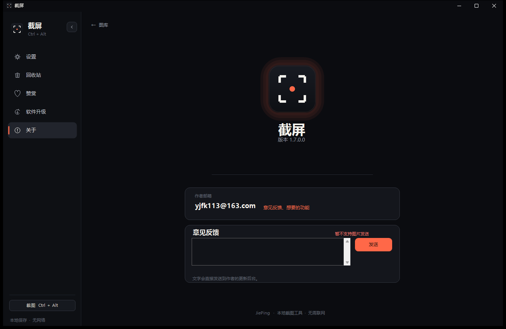

# 截屏 · JiePing

一个为 Windows 做的轻量截图工具，使用 C# / .NET Framework 4.8 / WinForms 编写。

打开后只有按时间排列的截图格子；常驻托盘，按快捷键冻结画面即可框选窗口或自由框选区域。

> 本仓库只包含**客户端**源码。升级包统一通过 GitHub Releases 发布。

## 下载使用

**直接下载最新版：[JiePing.exe](https://github.com/SparkYokeHub/JiePing/releases/latest/download/JiePing.exe)**

- 单文件绿色版，不需要安装。
- 下载后双击运行即可；首次运行如遇 SmartScreen，选择“更多信息 → 仍要运行”。
- 旧版本可以在「软件升级」里检查并更新到最新版。
- 所有版本：[GitHub Releases](https://github.com/SparkYokeHub/JiePing/releases)

客户端默认读取：

```
https://github.com/SparkYokeHub/JiePing/releases/latest/download/update.txt
```

作者发布新版本后，用户点「检查更新」即可收到统一推送的升级包。


















## 功能

- 桌面快捷方式、托盘常驻、单实例。
- 默认 `Ctrl + Alt` 冻屏截图，支持窗口自动高亮、点击窗口、拖动框选。
- 自定义快捷键：完整键盘图、组合键实时亮起、点击/长按触发、延迟区间。
- 截图自动保存、复制到剪贴板、图库时间排序。
- 批量选择、批量移入回收站、批量彻底删除。
- 回收站还原、彻底删除确认。
- 鼠标悬停格子的删除胶囊按钮。
- 拖拽截图到微信、QQ、浏览器等程序。
- 放大预览：上一张/下一张/回收站/还原/删除/关闭，底部按钮均可点击。
- 设置图片存放位置，迁移现有截图和回收站。
- 开机自启动开关。
- 关闭窗口行为：隐藏到托盘 / 直接退出。
- 侧栏收起为图标栏。
- 中文 / English 切换。
- 赞赏页（支付宝 / 微信，自愿赞赏，不影响功能）。
- 在线升级：读取 GitHub Releases 的 `update.txt`，在软件内下载并校验升级包。

## 截图

截图由程序在实际运行中生成，`docs/` 下是界面示例图。

## 构建

需要 Windows 和 .NET Framework 4.x（Windows 10/11 自带）。

```powershell
powershell -NoProfile -ExecutionPolicy Bypass -File .\build.ps1
```

输出：

```
dist\JiePing.exe
```

安装到当前用户目录并创建桌面快捷方式：

```powershell
powershell -NoProfile -ExecutionPolicy Bypass -File .\install.ps1
```

只安装、不自动启动：

```powershell
powershell -NoProfile -ExecutionPolicy Bypass -File .\install.ps1 -NoLaunch
```

卸载（默认保留截图）：

```powershell
powershell -NoProfile -ExecutionPolicy Bypass -File .\uninstall.ps1
```

## 项目结构

```
src\              C# 源码
assets\           图标、赞赏码图片
docs\             界面示例图
build.ps1         编译脚本
install.ps1       安装与桌面快捷方式
uninstall.ps1     卸载
.github\workflows\release.yml  自动构建与发布
```

## 发布新版本（作者统一推送）

1. 修改 `src/AssemblyInfo.cs` 里的版本号，例如 `1.9.0.0`。
2. 提交并推送：
   ```powershell
   git add .
   git commit -m "Release 1.9.0.0"
   git push
   ```
3. 打标签并推送：
   ```powershell
   git tag v1.9.0.0
   git push origin v1.9.0.0
   ```
4. GitHub Actions 会自动：
   - 构建 `JiePing.exe`；
   - 生成 `update.txt`；
   - 创建 Release 并上传两个文件。
5. 客户端读取 `releases/latest/download/update.txt`，用户点「检查更新」即可收到。

标签建议与 `AssemblyInfo.cs` 版本一致，例如 `v1.9.0.0`。

## 轻量设计

- 单个 exe 约 589 KB，依赖系统自带 .NET Framework 4.8，不打包运行时。
- 快捷键监听使用系统键盘钩子；截图浮层只在截图时创建。
- 缩略图异步加载，最多 3 个并发。
- 除可选的在线升级外，不主动联网。

## 说明

- 程序未做商业代码签名；首次运行可能出现 SmartScreen 提示，选择“更多信息 → 仍要运行”。
- 赞赏码仅用于自愿支持作者，不购买任何商品或服务，也不解锁任何功能。
- 在线升级使用 GitHub Releases 统一发布。

## License

MIT License，详见 [LICENSE](LICENSE)。
